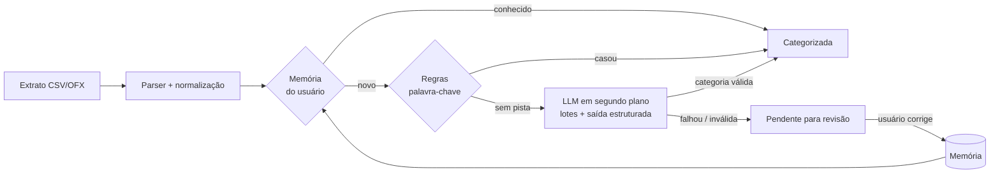
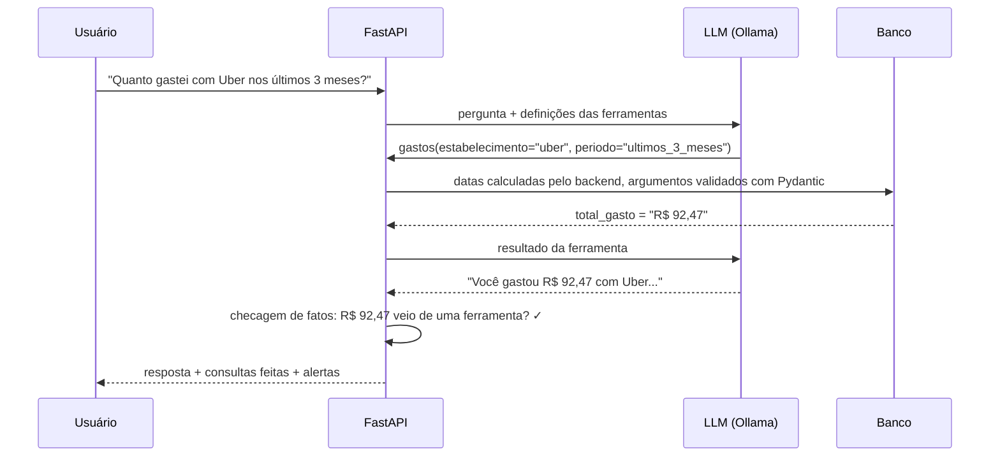

# 💰 Finanças IA: organizador de finanças pessoais com LLM

Importe o extrato do seu banco e veja seus gastos organizados automaticamente. A categorização
combina **memória das suas correções**, **regras determinísticas** e um **modelo de linguagem
rodando localmente** (Ollama). Tudo isso **sem custo**: nenhuma API paga é necessária, e os seus
dados financeiros não saem da sua máquina.


<!-- Adicione aqui um GIF ou print do dashboard: docs/demo.gif -->

## Funcionalidades

- **Importação de extratos** do Nubank (conta e cartão), Banco Inter, CSVs genéricos e **OFX**,
  com detecção automática do formato, de separador decimal brasileiro (`1.234,56`) e da codificação.
- **Deduplicação**: reimportar o mesmo extrato não duplica nada, mas duas compras idênticas no
  mesmo dia continuam sendo duas.
- **Categorização em cascata** (memória → regras → LLM), com a origem e a confiança de cada
  categoria visíveis na interface.
- **Aprendizado com correções**: ao trocar a categoria de uma transação, o app memoriza o
  estabelecimento e aplica a escolha às compras semelhantes, passadas e futuras.
- **Assistente em linguagem natural**: "quanto gastei com alimentação nos últimos 3 meses?",
  "quais foram meus 5 maiores gastos?". A LLM consulta os dados por meio de ferramentas, e a
  interface mostra quais consultas foram feitas.
- **Dashboard** com receitas, despesas, saldo, gastos por categoria, evolução mensal e a taxa de
  automação da categorização.
- **Dados de exemplo** com um clique, para conhecer o app sem precisar do seu extrato.

## Como a IA foi aplicada



Decisões de projeto:

| Decisão | Por quê |
|---|---|
| **LLM como última etapa**, não como primeira | Etapas determinísticas são instantâneas, gratuitas e previsíveis. No extrato de exemplo, as regras resolvem ~85% das transações, e só o restante vai para o modelo. |
| **Saída estruturada (JSON Schema)** | As categorias entram no schema como `enum`, então o modelo não consegue inventar nomes. Mesmo assim, toda resposta é validada: índice inventado ou saída de dinheiro classificada como receita são descartados. |
| **LLM em segundo plano** | Numa CPU sem GPU o modelo leva alguns segundos por estabelecimento. A importação responde na hora (0,2 s no extrato de exemplo) com memória e regras, e a LLM roda depois; a interface avisa quando ela termina. |
| **Menos chamadas à LLM** | Compras repetidas no mesmo estabelecimento viram uma única pergunta, e decisões de importações anteriores são reaproveitadas. No extrato de exemplo, 9 pendentes viram 4 perguntas. |
| **Degradação graciosa** | Se a LLM estiver fora do ar, a importação continua com memória e regras, e a interface avisa. A IA melhora o app, mas o app não depende dela. |
| **Provedores plugáveis** | `LLM_PROVIDER=ollama` (padrão, local e gratuito), `anthropic` (Claude, opcional) ou `none`. Os provedores compartilham o mesmo prompt e o mesmo schema, e os testes usam um provedor falso determinístico. |
| **Rastreabilidade** | Cada transação guarda `categorized_by` (`memory`, `rule`, `llm`, `manual`) e a confiança, o que permite auditar e medir cada etapa. |
| **Valores em centavos (`int`)** | Evita erros de arredondamento de ponto flutuante em dinheiro. |

### Assistente com ferramentas (tool use)

Princípio: **a LLM só escolhe a intenção; o backend faz todo o resto.** Ela recebe três
ferramentas de leitura (`gastos`, `resumo_financeiro`, `evolucao_mensal`), decide qual chamar e
com quais filtros, e o backend executa a consulta em SQL e devolve os valores prontos.



**Como o desenho chegou aqui (testado com `qwen2.5:3b` real).** A primeira versão dava à LLM
uma busca genérica com datas livres, e ela errou 2 de 3 perguntas: calculou o período errado,
listou o salário como "gasto" e copiou sinais negativos para a resposta. A segunda versão tirou
essas tarefas do modelo:

- **Períodos como opção fechada** (`este_mes`, `mes_passado`, `ultimos_3_meses`...): as datas são
  calculadas pelo backend, porque modelos pequenos erram aritmética de datas.
- **A ferramenta `gastos` só enxerga despesas** e devolve valores positivos já formatados
  ("R$ 1.800,00"). Não sobra conta para a LLM fazer.
- **Filtros de estabelecimento e de categoria separados**, com descrições que dizem quando usar
  cada um.

Com isso, o modelo escolheu a ferramenta e os filtros certos nas 5 perguntas testadas. Mas, em
uma delas, citou a descrição certa com um **valor inventado** (R$ 349,65 no lugar de R$ 261,66).
Por isso existe a **checagem de fatos**: todo valor em R$ da resposta precisa aparecer nos
resultados das ferramentas; se não aparecer, a interface mostra um alerta.

- Os argumentos são validados; um erro (categoria inexistente, período inválido) volta para a
  LLM como mensagem, para ela corrigir sozinha.
- As ferramentas são só de leitura. O loop tem limite de passos e o histórico, de tamanho.
- O loop do Ollama é testado com um servidor HTTP simulado (`httpx.MockTransport`), sem rede.

## Avaliação da IA

Não basta chamar uma LLM: é preciso medir se ela acerta. O diretório [`backend/evals/`](backend/evals/)
tem **145 transações rotuladas à mão**, com casos difíceis de propósito (estornos, maquininhas,
siglas, nomes de pessoas), e um script que roda o **mesmo pipeline do app** e mede cada etapa:

```bash
cd backend
python -m evals.run_eval                                    # só regras
python -m evals.run_eval --provider ollama --model qwen2.5:3b
```

| Configuração | Acerto de ponta a ponta | Pendentes | LLM: acerto no que as regras não resolveram |
|---|---|---|---|
| Só regras | 69,0% | 45 | — |
| Regras + `qwen2.5:3b`, prompt inicial | 73,8% | 27 | 15,6% |
| Regras + `qwen2.5:3b`, prompt revisado | **88,3%** | **2** | **62,2%** |

As regras cobrem 69% das transações com 100% de acerto. Medido em um notebook com Intel i5 de 8ª
geração, 8 GB de RAM e sem GPU: cerca de 4 minutos para as 45 transações que chegam à LLM.

O que a avaliação mostrou:

1. **Dois bugs nas regras** ("UBER EATS" virava Transporte, "MERCADO PAGO \*LOJA" virava Mercado).
   Foram corrigidos, viraram testes de regressão, e o CI falha se alguma regra voltar a errar.
2. **O prompt inicial era ruim para um modelo pequeno.** A LLM respondia só 18 de 45 transações,
   e quase tudo como "Outros". A revisão foi: uma descrição curta por categoria, categorias como
   `enum` no schema, sinal escrito por extenso ("saída de R$ 150,00"), "Outros" só como último
   recurso e lotes de 10 em vez de 25. O acerto da LLM foi de 15,6% para 62,2%.
3. **A confiança informada pelo modelo não serve.** Ele diz ≥ 60% de confiança inclusive quando
   erra, então ela não é usada para decidir o que revisar.

> **Limitação:** o prompt foi ajustado olhando os erros deste mesmo conjunto, então 62,2% tende
> a ser otimista. As descrições das categorias são genéricas e não citam lojas do conjunto, mas
> o ideal é um segundo conjunto, separado, só para teste.

## Stack

**Backend:** Python 3.12, FastAPI, SQLAlchemy 2, Pydantic, SQLite (dev) / PostgreSQL (Docker), pytest, Ruff
**Frontend:** React 19, TypeScript, Vite, Tailwind CSS, TanStack Query, Recharts
**IA:** Ollama (`qwen2.5:3b` por padrão) · Claude (opcional)
**Infra:** Docker multi-stage (um container serve a API e o frontend), Docker Compose, GitHub Actions

## Rodando localmente

### Opção 1: Docker (mais simples)

```bash
docker compose up --build                    # app + PostgreSQL, categorização por memória e regras
docker compose --profile ollama up --build   # + LLM local (baixa ~2 GB na primeira vez)
```

Acesse http://localhost:8000. A documentação interativa da API fica em http://localhost:8000/docs.

### Opção 2: desenvolvimento

Pré-requisitos: Python 3.12+ e Node 20+. O [Ollama](https://ollama.com/download) é opcional.

```bash
# LLM local (opcional, mas recomendado)
ollama pull qwen2.5:3b

# Backend: http://localhost:8000
cd backend
python -m venv .venv
.venv/Scripts/activate        # Linux/macOS: source .venv/bin/activate
pip install -r requirements-dev.txt
uvicorn app.main:app --reload

# Frontend: http://localhost:5173 (em outro terminal)
cd frontend
npm install
npm run dev
```

Sem o Ollama instalado, o app funciona normalmente, só que sem a etapa de LLM. Para testar,
use o botão **"Usar dados de exemplo"** ou importe [`exemplos/extrato-nubank-exemplo.csv`](exemplos/extrato-nubank-exemplo.csv).

### Configuração

Variáveis de ambiente (ou `backend/.env`, veja [`backend/.env.example`](backend/.env.example)):

| Variável | Padrão | Descrição |
|---|---|---|
| `DATABASE_URL` | `sqlite:///./financas.db` | Qualquer URL do SQLAlchemy |
| `LLM_PROVIDER` | `ollama` | `ollama`, `anthropic` ou `none` |
| `OLLAMA_MODEL` | `qwen2.5:3b` | Qualquer modelo do Ollama com suporte a saída estruturada |
| `ANTHROPIC_API_KEY` | — | Só para `LLM_PROVIDER=anthropic` (serviço pago) |

## Testes

```bash
cd backend
pytest          # 69 testes: parsers, categorização, aprendizado, assistente, API e avaliação
ruff check .
```

O CI roda lint, testes, o build do frontend e o build da imagem Docker a cada push.

## Estrutura

```
backend/app/
├── main.py                  # app FastAPI, CORS, frontend estático
├── models.py / schemas.py   # SQLAlchemy e Pydantic
├── routers/                 # transações, dashboard, importação, categorias, assistente
└── services/
    ├── assistant.py         # ferramentas do assistente e prompt
    ├── importer.py          # parsers de CSV (Nubank, Inter, genérico) e OFX
    ├── ingest.py            # caso de uso: importar → deduplicar → categorizar
    ├── text.py              # normalização de descrições e chave do estabelecimento
    └── categorizer/
        ├── pipeline.py      # cascata memória → regras → LLM
        ├── rules.py         # regras de palavra-chave
        ├── defaults.py      # categorias e palavras-chave padrão
        └── llm.py           # provedores Ollama e Anthropic: categorização e tool use
backend/evals/               # conjunto rotulado + script de avaliação
frontend/src/
├── pages/                   # Dashboard, Transações, Assistente, Importar
└── components/ui.tsx
```

## Próximos passos

- [ ] Avaliação automatizada do assistente (perguntas com respostas esperadas), como já existe para a categorização
- [ ] Segundo conjunto rotulado, separado, só para teste (evita ajustar o prompt para a prova)
- [ ] Comparar modelos menores (`qwen2.5:1.5b`) e maiores com a mesma avaliação
- [ ] Categoria "Cuidados pessoais" (barbearia, salão), hoje ausente e fonte de erro da LLM
- [ ] Resumo mensal gerado pela IA, com alertas de gastos fora do padrão
- [ ] Lançamento por texto livre ("gastei 45 no mercado ontem")
- [ ] Métricas de acerto da IA em produção, a partir das correções do usuário
- [ ] Autenticação e múltiplos usuários
- [ ] Migrações com Alembic
