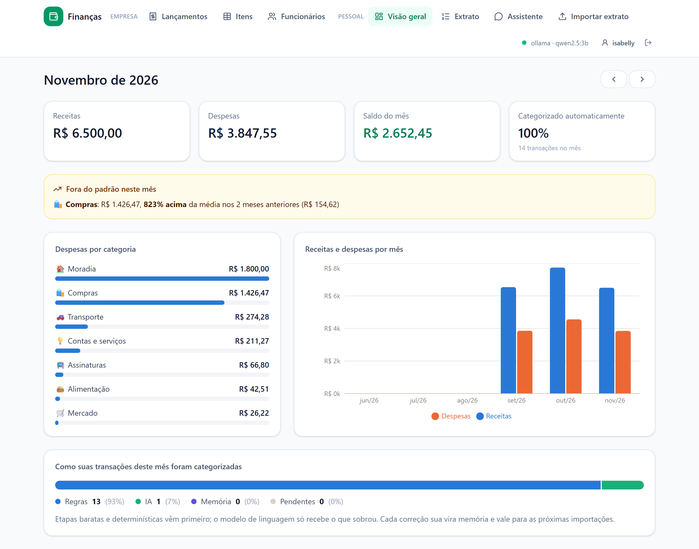
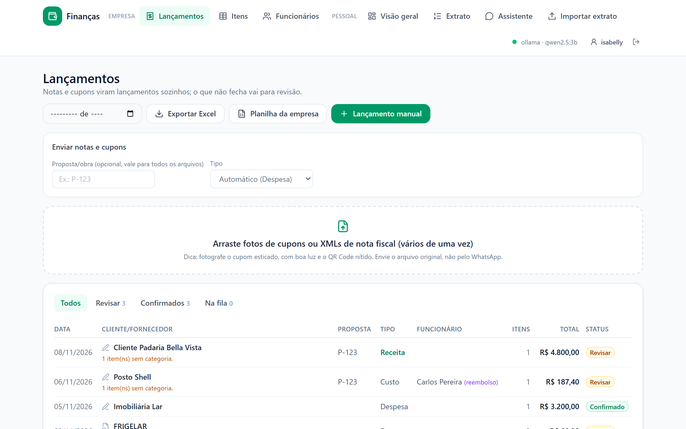
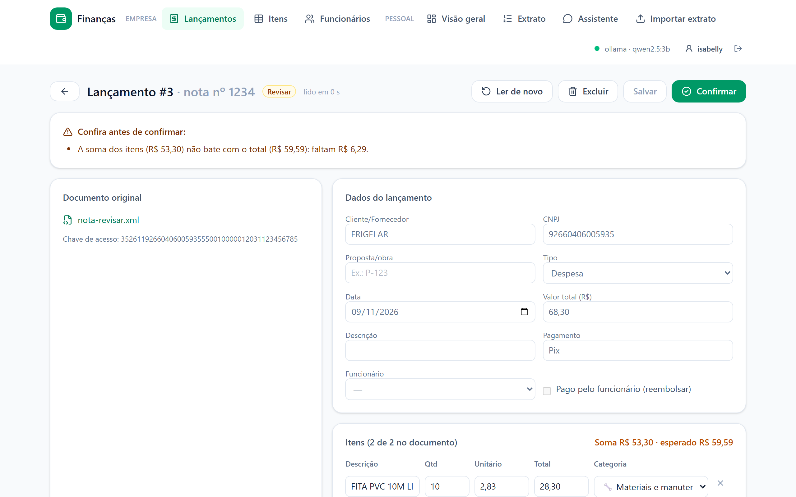
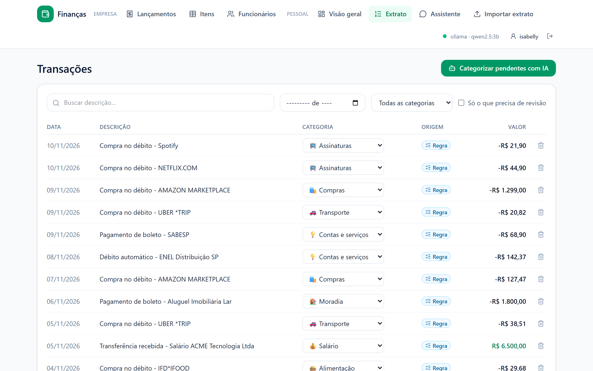
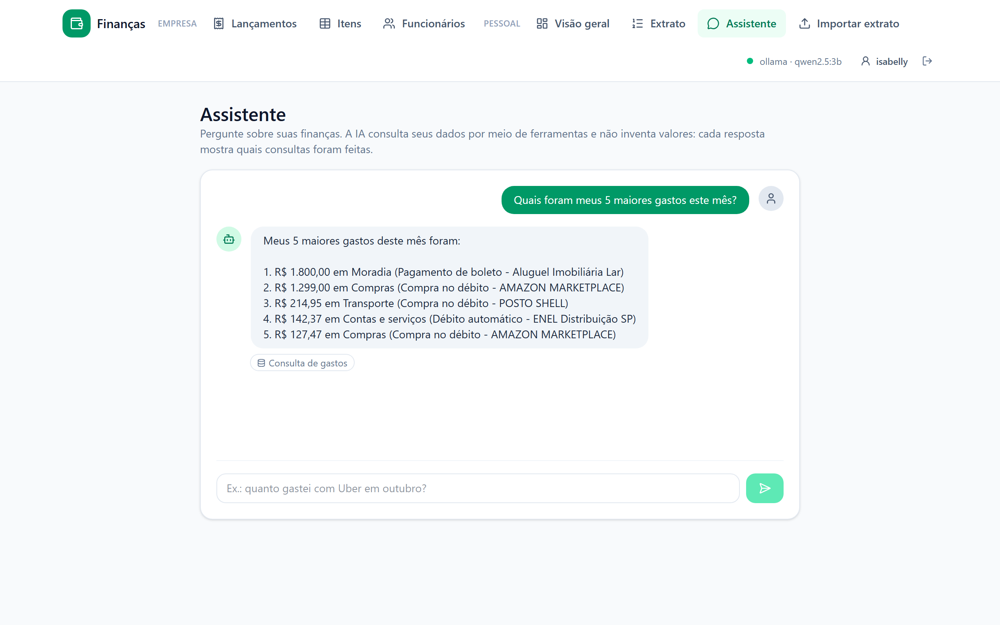
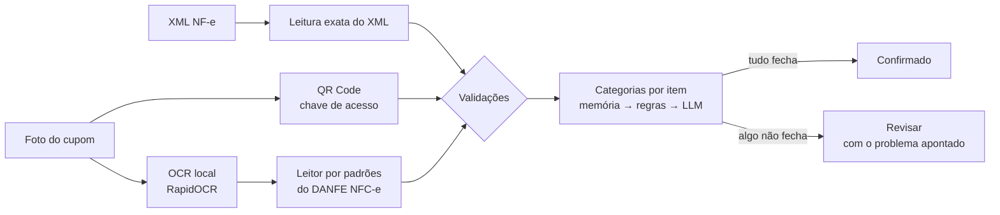
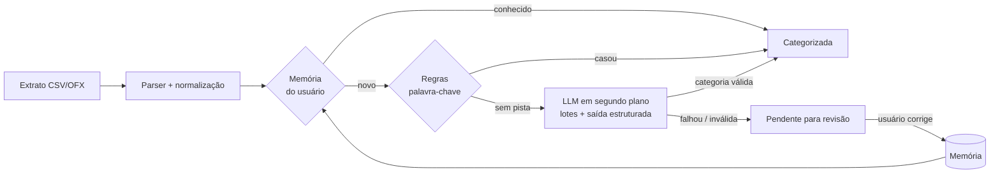
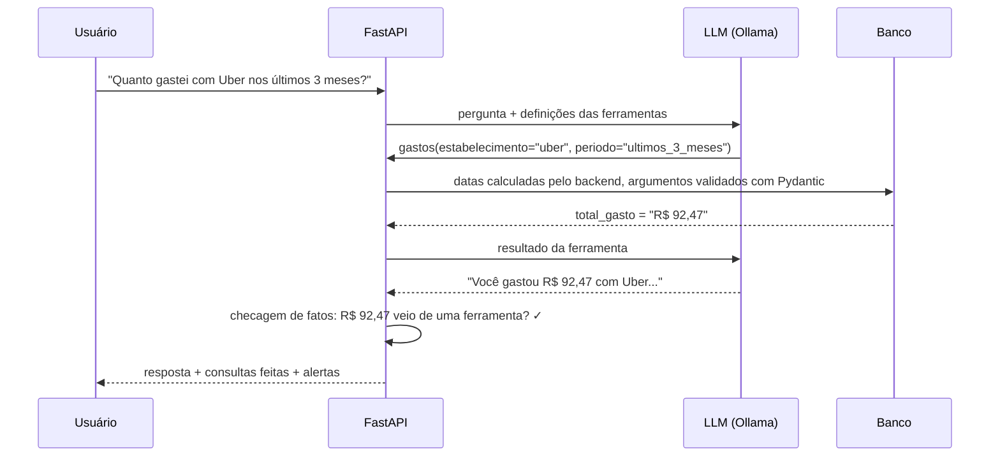

# 🧾 Finanças: lançamento automático de notas fiscais e cupons

Sistema para pequenas empresas que **substitui a planilha preenchida à mão**: você envia o XML
da NF-e ou a foto do cupom fiscal, e o lançamento da despesa é feito sozinho, com fornecedor,
itens, categorias e validação dos valores. O que não fecha vai para revisão, com o problema
apontado. No fim do mês, exporta tudo para Excel.

Tudo roda **sem custo e localmente**: OCR e modelo de linguagem (Ollama) na própria máquina,
sem API paga, e os documentos fiscais não saem do computador.

O sistema tem duas áreas, com dados e **categorias separados**:

- **Empresa**: notas, cupons, planilha da empresa, funcionários e Power BI. Categorias como
  "Materiais e manutenção", "Fretes e entregas" e "Receita de vendas".
- **Pessoal**: extrato bancário, dashboard e assistente. Categorias como "Salário" e "Renda extra".

Gastos do dia a dia (Alimentação, Transporte, Contas e serviços...) valem nas duas áreas. A
separação existe porque misturar as listas derrubou o acerto da IA (veja
[Avaliação da IA](#avaliação-da-ia)).




| Lançamentos da empresa | Revisão: o que não fecha é apontado |
|---|---|
|  |  |
| **Extrato categorizado** (com a origem: regra, memória ou IA) | **Assistente** (consulta os dados por ferramentas) |
|  |  |

<sub>Prints do app rodando no Docker com o Ollama (`qwen2.5:3b`), só com dados fictícios.</sub>

## Funcionalidades

### Lançamentos de despesa
- **XML de NF-e/NFC-e**: leitura exata do layout nacional 4.00, com proteção contra XML malicioso.
- **Foto de cupom (NFC-e)**: QR Code → OCR local → leitor por padrões → validação.
- **Lançamento manual**: aluguel, serviço sem nota, folha de pagamento, benefícios.
- **Funcionários**: lançamentos ligados a funcionários (folha, benefícios) e **reembolsos** de
  despesas pagas por eles, com o total a devolver para cada um.
- **Validações automáticas**: soma dos itens = total, quantidade de itens, quantidade × unitário,
  dígitos verificadores de CNPJ e chave de acesso, e **nota duplicada** pela chave de acesso.
- **Revisão** com a foto ao lado dos dados extraídos e a soma conferida enquanto se edita.
- **Categorias por item** com a mesma cascata da IA (memória → regras → LLM); cada correção vira
  memória para as próximas notas.
- **Integração com a planilha que a empresa já usa**, nos dois sentidos:
  - *Carregar*: o histórico da planilha vira lançamentos no sistema (a tabela é encontrada
    sozinha, mesmo com título acima; reimportar não duplica).
  - *Atualizar*: envia-se a planilha atual e recebe-se o mesmo arquivo com os lançamentos novos.
    Abas, formatação e totais são preservados: as linhas entram antes da linha de TOTAL, e
    fórmulas como `=SOMA(G4:G20)` são estendidas. Linhas que já estão lá não se repetem.
- **Power BI**: fonte de dados (`/api/bi/lancamentos.json`) com todos os itens e dimensões
  prontas, atualizada com um clique. Consulta Power Query e medidas DAX de DRE em
  [`docs/power-bi.md`](docs/power-bi.md).
- **Tela de itens**: todos os itens de todas as notas numa tabela, com filtros (mês, proposta,
  tipo, categoria, busca), totais por tipo e por categoria e exportação do que está filtrado.
  Responde "quanto gastei de tubo de cobre este mês?" ou "quais materiais foram para a P-123?".
- **Proposta/obra e Tipo** (Custo, Despesas, Estoque, Receita, Caixa) em cada lançamento: o
  material comprado para uma obra vira custo daquela proposta.
- **Exportação para Excel no formato da planilha da empresa** (`Data | Mês | Cliente/Fornecedor |
  Proposta | Descrição | Tipo | Valor (R$)`, uma linha por item), com abas de **resultado por
  proposta** (receitas − custos), totais por categoria, reembolsos e conferência das notas.
- **Fila em segundo plano**: o envio responde na hora; a leitura acontece depois. Se o servidor
  reiniciar no meio, as notas em "Processando" e as transações esperando a LLM continuam
  sozinhas ao iniciar (o estado da fila fica no banco, não só na memória).
- **Aviso de divergência com a planilha**: se uma linha não pode ser lançada (ex.: sem data), mas
  a planilha soma o valor nos totais dela, a importação diz a linha, o valor e o mês afetado.

### Login e dados individuais
- **Cada pessoa tem o próprio organizador**: lançamentos, extrato, funcionários, categorias
  criadas, memória de correções e Power BI. Ninguém vê, altera ou apaga os dados de outra pessoa,
  nem acertando o número de um lançamento na URL.
- O isolamento é **central** ([`app/tenancy.py`](backend/app/tenancy.py)): toda consulta de uma
  sessão logada recebe `user_id = X` automaticamente (eventos do SQLAlchemy), e toda linha nova
  recebe o dono. Assim, uma rota nova não "esquece" de filtrar. As filas em segundo plano
  (leitura de notas, LLM) processam cada arquivo em nome do dono dele.
- Usuário e senha em todas as rotas de dados. Senhas com **scrypt** e sal; a sessão é um cookie
  `HttpOnly` e `SameSite=Lax`, e o banco guarda só o hash do token.
- **Primeiro acesso**: sem nenhum usuário, a tela pede para criar a conta, e o que já estava no
  sistema fica com ela. Essa primeira conta **administra o sistema**: só ela cadastra outras
  pessoas, em **Minha conta**, e elas começam com o organizador vazio.
- **Limite de tentativas**: 5 senhas erradas em 15 minutos bloqueiam aquele usuário, e 30 erros
  bloqueiam o IP (quem testa muitos usuários). O bloqueio vale também para o Power BI e para
  usuários que não existem, para não revelar quem existe. O limite por IP é alto de propósito: no
  Docker, todas as pessoas chegam ao app com o mesmo IP.
- **Power BI** entra com login *Básico* (o mesmo usuário e senha), já que não guarda cookie.
- Trocar a senha encerra as sessões abertas em outros aparelhos. Esqueceu a senha?
  `python scripts/usuario.py NOME` (dentro de `backend/`) cria o usuário ou troca a senha;
  com `--admin`, também dá acesso de administração.

### Finanças a partir do extrato bancário
- **Importação de extratos** do Nubank (conta e cartão), Banco Inter, CSVs genéricos e **OFX**,
  com detecção automática do formato, de separador decimal brasileiro (`1.234,56`) e da codificação.
- **Deduplicação**: reimportar o mesmo extrato não duplica nada, mas duas compras idênticas no
  mesmo dia continuam sendo duas.
- **Categorização em cascata** (memória → regras → LLM), com a origem e a confiança de cada
  categoria visíveis na interface.
- **Aprendizado com correções**: ao trocar a categoria de uma transação, o app memoriza o
  estabelecimento e aplica a escolha às compras semelhantes, passadas e futuras.
- **Assistente em linguagem natural**: "quanto gastei com alimentação nos últimos 3 meses?",
  "quais foram meus 5 maiores gastos?". A LLM consulta os dados por meio de ferramentas, e a
  interface mostra quais consultas foram feitas.
- **Dashboard** com receitas, despesas, saldo, gastos por categoria, evolução mensal e a taxa de
  automação da categorização.
- **Gastos fora do padrão**: o dashboard avisa quando uma categoria passa muito da média dos
  meses anteriores ("Compras: R$ 1.426,47, 823% acima da média"). É uma regra fixa, sem LLM:
  50% acima da média **e** pelo menos R$ 50 a mais (para R$ 12 contra R$ 8 não virar alerta),
  e a média conta só os meses em que houve movimento, então quem começou a usar o app no mês
  passado não tem meses vazios contados como "gastou zero".
- **Lançamento por texto**: "gastei 45 no mercado ontem" ou "recebi 300 de freela dia 5" viram
  uma prévia editável, salva só quando você confirma. Veja [Lançamento por texto](#lançamento-por-texto).
- **Dados de exemplo** com um clique, para conhecer o app sem precisar do seu extrato.

## Leitura de notas e cupons



**Por que um leitor por padrões em vez de pedir tudo à LLM?** Testado com uma foto real de cupom
(23 itens) e `qwen2.5:3b` na CPU, a extração por LLM **passou de 30 minutos e não terminou**: o
modelo entra em loop com linhas repetidas (o cupom tinha 10 itens idênticos). O layout do DANFE
NFC-e é padronizado, então o leitor por padrões resolve em milissegundos. A LLM ficou para o que
faz bem e rápido, categorizar itens curtos, e a extração por LLM continua disponível como
segunda tentativa opcional (`PHOTO_LLM_FALLBACK=true`), útil com um modelo rápido como o Claude.

Resultado na foto real (enviada por WhatsApp, com o QR Code ilegível):

| | |
|---|---|
| Itens lidos | 22 de 23, em ~10 s de OCR |
| Total | R$ 1.034,33, correto |
| Validação | "A soma dos itens não bate com o total: **faltam R$ 52,50**", exatamente o item que o OCR perdeu |
| Categorias | 17 itens por regras, todos certos; 4 pela LLM, genéricos ("Compras"); 1 ilegível, deixado para a revisão |
| Status | **Revisar**: nada errado foi lançado em silêncio |

Achados que viraram código:
- **Contexto ajuda a LLM:** "HANOMETRO" sozinho (OCR de "MANÔMETRO") virava *Transporte*; com
  "item de OCR comprado na FRIGELAR", deixou de ser absurdo.
- **Não pergunte o que não tem resposta:** item com descrição ilegível não vai para a LLM, que
  só chutaria.
- **`num_predict` na LLM:** um limite de tamanho na resposta impede que um loop trave a fila.
- **Regras tolerantes a OCR**, só para itens: "TUB0" → tubo, "FITAPUC10..." → fita.
- **SEFAZ-SP:** a consulta pública recusa conexões automatizadas, então o sistema não depende dela.

## Como a IA foi aplicada



Decisões de projeto:

| Decisão | Por quê |
|---|---|
| **LLM como última etapa**, não como primeira | Etapas determinísticas são instantâneas, gratuitas e previsíveis. No extrato de exemplo, as regras resolvem ~85% das transações, e só o restante vai para o modelo. |
| **Saída estruturada (JSON Schema)** | As categorias entram no schema como `enum`, então o modelo não consegue inventar nomes. Mesmo assim, toda resposta é validada: índice inventado ou saída de dinheiro classificada como receita são descartados. |
| **LLM em segundo plano** | Numa CPU sem GPU o modelo leva alguns segundos por estabelecimento. A importação responde na hora (0,2 s no extrato de exemplo) com memória e regras, e a LLM roda depois; a interface avisa quando ela termina. |
| **Menos chamadas à LLM** | Compras repetidas no mesmo estabelecimento viram uma única pergunta, e decisões de importações anteriores são reaproveitadas. No extrato de exemplo, 9 pendentes viram 4 perguntas. |
| **Degradação graciosa** | Se a LLM estiver fora do ar, a importação continua com memória e regras, e a interface avisa. A IA melhora o app, mas o app não depende dela. |
| **Provedores plugáveis** | `LLM_PROVIDER=ollama` (padrão, local e gratuito), `anthropic` (Claude, opcional) ou `none`. Os provedores compartilham o mesmo prompt e o mesmo schema, e os testes usam um provedor falso determinístico. |
| **Rastreabilidade** | Cada transação guarda `categorized_by` (`memory`, `rule`, `llm`, `manual`) e a confiança, o que permite auditar e medir cada etapa. |
| **Valores em centavos (`int`)** | Evita erros de arredondamento de ponto flutuante em dinheiro. |

### Assistente com ferramentas (tool use)

Princípio: **a LLM só escolhe a intenção; o backend faz todo o resto.** Ela recebe três
ferramentas de leitura (`gastos`, `resumo_financeiro`, `evolucao_mensal`), decide qual chamar e
com quais filtros, e o backend executa a consulta em SQL e devolve os valores prontos.



**Como o desenho chegou aqui (testado com `qwen2.5:3b` real).** A primeira versão dava à LLM
uma busca genérica com datas livres, e ela errou 2 de 3 perguntas: calculou o período errado,
listou o salário como "gasto" e copiou sinais negativos para a resposta. A segunda versão tirou
essas tarefas do modelo:

- **Períodos como opção fechada** (`este_mes`, `mes_passado`, `ultimos_3_meses`...): as datas são
  calculadas pelo backend, porque modelos pequenos erram aritmética de datas.
- **A ferramenta `gastos` só enxerga despesas** e devolve valores positivos já formatados
  ("R$ 1.800,00"). Não sobra conta para a LLM fazer.
- **Filtros de estabelecimento e de categoria separados**, com descrições que dizem quando usar
  cada um.

Com isso, o modelo escolheu a ferramenta e os filtros certos nas 5 perguntas testadas. Mas, em
uma delas, citou a descrição certa com um **valor inventado** (R$ 349,65 no lugar de R$ 261,66).
Por isso existe a **checagem de fatos**: todo valor em R$ da resposta precisa aparecer nos
resultados das ferramentas; se não aparecer, a interface mostra um alerta.

- Os argumentos são validados; um erro (categoria inexistente, período inválido) volta para a
  LLM como mensagem, para ela corrigir sozinha.
- As ferramentas são só de leitura. O loop tem limite de passos e o histórico, de tamanho.
- O loop do Ollama é testado com um servidor HTTP simulado (`httpx.MockTransport`), sem rede.

### Lançamento por texto

A mesma cascata da categorização: **um leitor por padrões primeiro, a LLM só se ele não
entender**. Ele cobre as frases comuns na hora (valor com ou sem "R$", "1,5 mil", "ontem", "dia
5", "na sexta", "25/12"). A LLM entra quando o valor está por extenso ("netflix vinte e cinco") ou
quando há mais de um número sem "R$" ("2 pizzas por 80").

Testado com o `qwen2.5:3b` real, a primeira versão deixava a LLM decidir tudo e errou 3 de 7
frases: marcou "netflix vinte e cinco" como **receita**, ignorou o "sexta" de "no bar sexta" e
inventou a palavra "Vendendo" na descrição. A versão atual tira essas tarefas do modelo:

- **Data e tipo (despesa ou receita) são do backend**, pelas mesmas palavras-chave das regras.
  A LLM só devolve o valor e a descrição.
- **A descrição só pode ter palavras da frase**: o que o modelo inventa é descartado.
- **Checagem de fatos no valor**: se a frase tem números, o valor precisa ser um deles. Em "2
  pizzas por 80", o modelo respondeu 160 (calculou 2 × 80) e o backend recusou.
- **Avisos na prévia**: valor por extenso ou outros números na frase ("3 cafés de 7 reais": 7
  ou 21?) pedem para conferir.

Com isso, as 7 frases do teste saíram certas (ou com o aviso certo), em 4 a 11 s cada na CPU
quando a LLM é usada e na hora quando o leitor por padrões resolve.

## Avaliação da IA

Não basta chamar uma LLM: é preciso medir se ela acerta. O diretório [`backend/evals/`](backend/evals/)
tem dois conjuntos de transações rotuladas à mão, com casos difíceis de propósito (estornos,
maquininhas, siglas, nomes de pessoas), e um script que roda o **mesmo pipeline do app** e mede
cada etapa:

- `dataset.csv` (**desenvolvimento**, 145 transações): usado para ajustar as regras e o prompt.
- `teste.csv` (**teste**, 61 transações): nenhum estabelecimento em comum com o outro (um teste
  garante isso) e **nunca** usado para ajustar nada. É ele que mede o que o app faz com
  transações novas.

```bash
cd backend
python -m evals.run_eval                                    # só regras
python -m evals.run_eval --provider ollama --model qwen2.5:3b
python -m evals.run_eval --provider ollama --model qwen2.5:3b --dataset evals/teste.csv
```

| Configuração | Acerto de ponta a ponta | Pendentes | LLM: acerto no que as regras não resolveram |
|---|---|---|---|
| Só regras | 69,0% | 45 | — |
| Regras + `qwen2.5:3b`, prompt inicial | 73,8% | 27 | 15,6% |
| Regras + `qwen2.5:3b`, prompt revisado | **88,3%** | **2** | **62,2%** |

No conjunto de **teste** (o número que vale para transações novas):

| Configuração | Acerto de ponta a ponta | Regras: cobertura | LLM: acerto no que as regras não resolveram |
|---|---|---|---|
| Só regras | 49,2% | 49,2% | — |
| Regras + `qwen2.5:3b` | **82,0%** | 49,2% | **64,5%** |

As regras acertam 100% quando se aplicam nos dois conjuntos, mas cobrem bem menos transações
novas (49% contra 69%): foram escritas olhando o conjunto de desenvolvimento. A LLM se sai igual
nos dois (62% e 64%), então generaliza. Medido em um notebook com Intel i5 de 8ª geração, 8 GB de
RAM e sem GPU: cerca de 4 minutos para as 45 transações que chegam à LLM.

O que a avaliação mostrou:

1. **Dois bugs nas regras** ("UBER EATS" virava Transporte, "MERCADO PAGO \*LOJA" virava Mercado).
   Foram corrigidos, viraram testes de regressão, e o CI falha se alguma regra voltar a errar.
2. **O prompt inicial era ruim para um modelo pequeno.** A LLM respondia só 18 de 45 transações,
   e quase tudo como "Outros". A revisão foi: uma descrição curta por categoria, categorias como
   `enum` no schema, sinal escrito por extenso ("saída de R$ 150,00"), "Outros" só como último
   recurso e lotes de 10 em vez de 25. O acerto da LLM foi de 15,6% para 62,2%.
3. **A confiança informada pelo modelo não serve.** Ele diz ≥ 60% de confiança inclusive quando
   erra, então ela não é usada para decidir o que revisar.
4. **Uma regressão que nenhum teste pegou.** Quando as categorias de empresa entraram no
   sistema, a LLM do extrato passou a vê-las e o acerto dela caiu de 62,2% para 51,1% ("Venda
   OLX" virava *Receita de vendas*, "SAQUE BANCO24HORAS" virava *Fretes e entregas*). Os testes
   não notaram porque a avaliação com LLM não roda no CI. A correção foi dar a cada categoria
   um escopo (pessoal, empresa ou ambos) e o acerto voltou a 62,2%. Agora testes com um
   provedor falso, que rodam no CI, verificam que o extrato nunca recebe categorias de empresa.

> **Limitação:** os dois conjuntos foram rotulados pela mesma pessoa, e o de teste ainda é
> pequeno (61 transações): uma transação a mais ou a menos muda o acerto em 1,6 ponto.

## Stack

**Backend:** Python 3.12, FastAPI, SQLAlchemy 2, Pydantic, SQLite (dev) / PostgreSQL (Docker), pytest, Ruff
**Frontend:** React 19, TypeScript, Vite, Tailwind CSS, TanStack Query, Recharts
**IA:** Ollama (`qwen2.5:3b` por padrão) · Claude (opcional)
**Infra:** Docker multi-stage (um container serve a API e o frontend), Docker Compose, GitHub Actions,
migrações de banco com Alembic (aplicadas ao iniciar; bancos antigos são reconhecidos e atualizados sem perder dados)

## Rodando localmente

### Opção 1: Docker (mais simples)

Pré-requisito: [Docker Desktop](https://www.docker.com/products/docker-desktop/) (ou Docker + Compose no Linux).

```bash
docker compose up --build -d
```

Acesse http://localhost:8000 e crie a primeira conta. A documentação interativa da API fica em
http://localhost:8000/docs.

- Sobem dois containers: o **app** (API e frontend juntos) e o **PostgreSQL**. Os dados ficam em
  volumes (`pgdata` e `uploads`) e sobrevivem a `docker compose down` e a atualizações. Só
  `docker compose down -v` apaga os dados.
- **IA:** se o [Ollama](https://ollama.com/download) estiver instalado no computador, o app usa
  ele. Sem Ollama, a categorização segue com memória e regras. Para rodar o Ollama também dentro
  do Docker (baixa ~2 GB na primeira vez), crie um arquivo `.env` na raiz com
  `OLLAMA_BASE_URL=http://ollama:11434` e rode `docker compose --profile ollama up --build -d`.
  Isso exige memória: no Windows, o Docker roda numa máquina virtual com metade da RAM. Num
  notebook com 8 GB, só carregar o `qwen2.5:3b` levou **7 minutos dentro do Docker contra 14 s**
  no Ollama instalado direto no Windows, e a categorização passou do tempo limite. Por isso o
  padrão é usar o Ollama do computador; o Ollama no Docker vale para máquinas com 16 GB ou mais
  e para servidores Linux.
- **Reinício automático:** se o app cair, o Docker o reinicia, e as notas e transações que estavam
  na fila continuam de onde pararam.
- O app roda com um usuário sem privilégios dentro do container, e o banco não expõe porta para
  fora. Para trocar a senha do banco, defina `POSTGRES_PASSWORD` no `.env` antes do primeiro início.

### Opção 2: desenvolvimento

Pré-requisitos: Python 3.12+ e Node 20+. O [Ollama](https://ollama.com/download) é opcional.

```bash
# LLM local (opcional, mas recomendado)
ollama pull qwen2.5:3b

# Backend: http://localhost:8000
cd backend
python -m venv .venv
.venv/Scripts/activate        # Linux/macOS: source .venv/bin/activate
pip install -r requirements-dev.txt
uvicorn app.main:app --reload

# Frontend: http://localhost:5173 (em outro terminal)
cd frontend
npm install
npm run dev
```

Sem o Ollama instalado, o app funciona normalmente, só que sem a etapa de LLM. Para testar,
use o botão **"Usar dados de exemplo"** ou importe [`exemplos/extrato-nubank-exemplo.csv`](exemplos/extrato-nubank-exemplo.csv).

### Configuração

Variáveis de ambiente (ou `backend/.env`, veja [`backend/.env.example`](backend/.env.example)):

| Variável | Padrão | Descrição |
|---|---|---|
| `DATABASE_URL` | `sqlite:///./financas.db` | Qualquer URL do SQLAlchemy |
| `LLM_PROVIDER` | `ollama` | `ollama`, `anthropic` ou `none` |
| `OLLAMA_MODEL` | `qwen2.5:3b` | Qualquer modelo do Ollama com suporte a saída estruturada |
| `ANTHROPIC_API_KEY` | — | Só para `LLM_PROVIDER=anthropic` (serviço pago) |
| `UPLOAD_DIR` | `./data/uploads` | Onde ficam os XMLs e fotos enviados |
| `PHOTO_LLM_FALLBACK` | `false` | Reler por LLM cupons cuja soma não fecha (recomendado só com modelo rápido) |
| `COOKIE_SECURE` | `false` | Cookie de sessão só por HTTPS: ligue ao publicar o sistema com HTTPS |

## Testes

```bash
cd backend
pytest          # 180 testes: notas e cupons, planilha, itens, login, isolamento, migrações, IA
ruff check .

cd frontend
npx playwright install chromium   # só na primeira vez
npm run test:e2e                  # teste end-to-end num navegador de verdade
```

O **teste end-to-end** (Playwright) abre o app num Chromium, cria a conta, envia um XML de nota
fiscal, carrega os dados de exemplo, confere o alerta do dashboard, faz um lançamento por texto
e testa o erro de senha. Ele sobe
a API sozinho, com um banco novo numa pasta temporária ([`scripts/e2e_server.py`](backend/scripts/e2e_server.py)),
então nunca toca no banco de desenvolvimento. Logo na primeira execução, ele achou um falso
alarme que os testes de unidade tratavam como "esperado": **toda NF-e com desconto num item ia
para revisão**, porque a conta quantidade × unitário não considerava o desconto. No XML essa
conta é redundante (a SEFAZ já recusa nota em que ela não fecha), e agora só vale para fotos,
onde costuma indicar erro de OCR.

O CI roda lint, testes, o build do frontend e o teste end-to-end a cada push, e depois **sobe o
app no Docker** com PostgreSQL e faz um teste de fumaça: cria uma conta e envia uma nota. Foi
esse teste que faltou para pegar um erro de permissão na pasta de uploads, que só aparecia com o
container rodando.

## Estrutura

```
backend/app/
├── main.py                  # app FastAPI, CORS, frontend estático, rotas protegidas
├── auth.py                  # senhas (scrypt), sessões por cookie e HTTP Basic (Power BI)
├── tenancy.py               # isolamento: cada usuário só enxerga as próprias linhas
├── models.py / schemas.py   # SQLAlchemy e Pydantic
├── routers/                 # login, lançamentos, funcionários, extrato, dashboard, assistente, BI
└── services/
    ├── fiscal/
    │   ├── nfe_xml.py       # XML de NF-e/NFC-e (layout 4.00)
    │   ├── photo.py         # foto: QR Code + OCR
    │   ├── receipt_parser.py# leitor por padrões do DANFE NFC-e
    │   ├── keys.py          # chave de acesso e CNPJ (dígitos verificadores)
    │   ├── validation.py    # regras que decidem: confirmar ou revisar
    │   ├── items.py         # categorias dos itens (memória → regras → LLM)
    │   ├── processor.py     # fila em segundo plano: arquivo → lançamento
    │   └── export.py        # Excel (lançamentos, itens, categorias, reembolsos)
    ├── assistant.py         # ferramentas do assistente e prompt
    ├── importer.py          # parsers de CSV (Nubank, Inter, genérico) e OFX
    ├── ingest.py            # caso de uso: importar → deduplicar → categorizar
    ├── text.py              # normalização de descrições e chave do estabelecimento
    └── categorizer/
        ├── pipeline.py      # cascata memória → regras → LLM
        ├── rules.py         # regras de palavra-chave
        ├── defaults.py      # categorias e palavras-chave padrão
        └── llm.py           # provedores Ollama e Anthropic: categorização e tool use
backend/evals/               # conjuntos rotulados (desenvolvimento e teste) + avaliação
backend/scripts/             # reimportar a planilha da empresa; criar usuário / trocar senha
frontend/src/
├── pages/                   # Lançamentos, revisão, Funcionários, Extrato, Assistente
└── components/ui.tsx
```

## Próximos passos

- [ ] Leitura do QR Code ao vivo pela câmera do celular (mais confiável que foto)
- [ ] Conciliação: ligar cada lançamento ao pagamento no extrato bancário
- [ ] Conjunto de fotos de cupons rotuladas para medir o leitor como já é medida a categorização
- [ ] Avaliação automatizada do assistente (perguntas com respostas esperadas), como já existe para a categorização
- [x] Segundo conjunto rotulado, separado, só para teste (evita ajustar o prompt para a prova)
- [ ] Aumentar o conjunto de teste e pedir a outra pessoa para rotular parte dele
- [ ] Comparar modelos menores (`qwen2.5:1.5b`) e maiores com a mesma avaliação
- [ ] Categoria "Cuidados pessoais" (barbearia, salão), hoje ausente e fonte de erro da LLM
- [x] Alertas de gastos fora do padrão no dashboard
- [ ] Resumo mensal escrito pela IA, a partir dos alertas (com checagem de fatos)
- [x] Lançamento por texto livre ("gastei 45 no mercado ontem")
- [ ] Métricas de acerto da IA em produção, a partir das correções do usuário
- [x] Login com múltiplos usuários, cada um com os próprios dados
- [ ] Compartilhar um organizador entre pessoas (ex.: sócios da mesma empresa)
- [x] Limite de tentativas de login e conta administradora
- [ ] Guardar as tentativas de login no banco ou no Redis, para valer com vários processos do servidor
