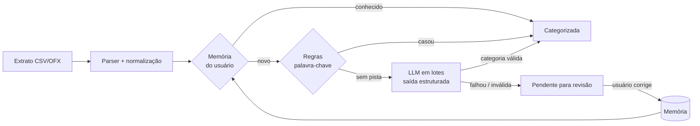

# 💰 Finanças IA: organizador de finanças pessoais com LLM

Importe o extrato do seu banco e veja seus gastos organizados automaticamente. A categorização
combina **memória das suas correções**, **regras determinísticas** e um **modelo de linguagem
rodando localmente** (Ollama). Tudo isso **sem custo**: nenhuma API paga é necessária, e os seus
dados financeiros não saem da sua máquina.


<!-- Adicione aqui um GIF ou print do dashboard: docs/demo.gif -->

## Funcionalidades

- **Importação de extratos** do Nubank (conta e cartão), Banco Inter, CSVs genéricos e **OFX**,
  com detecção automática do formato, de separador decimal brasileiro (`1.234,56`) e da codificação.
- **Deduplicação**: reimportar o mesmo extrato não duplica nada, mas duas compras idênticas no
  mesmo dia continuam sendo duas.
- **Categorização em cascata** (memória → regras → LLM), com a origem e a confiança de cada
  categoria visíveis na interface.
- **Aprendizado com correções**: ao trocar a categoria de uma transação, o app memoriza o
  estabelecimento e aplica a escolha às compras semelhantes, passadas e futuras.
- **Dashboard** com receitas, despesas, saldo, gastos por categoria, evolução mensal e a taxa de
  automação da categorização.
- **Dados de exemplo** com um clique, para conhecer o app sem precisar do seu extrato.

## Como a IA foi aplicada



Decisões de projeto:

| Decisão | Por quê |
|---|---|
| **LLM como última etapa**, não como primeira | Etapas determinísticas são instantâneas, gratuitas e previsíveis. No extrato de exemplo, as regras resolvem ~85% das transações, e só o restante vai para o modelo. |
| **Saída estruturada (JSON Schema)** | O modelo é obrigado a responder no formato esperado. Mesmo assim, toda resposta é validada: categoria fora da lista ou índice inventado são descartados. |
| **Degradação graciosa** | Se a LLM estiver fora do ar, a importação continua com memória e regras, e a interface avisa. A IA melhora o app, mas o app não depende dela. |
| **Provedores plugáveis** | `LLM_PROVIDER=ollama` (padrão, local e gratuito), `anthropic` (Claude, opcional) ou `none`. Os provedores compartilham o mesmo prompt e o mesmo schema, e os testes usam um provedor falso determinístico. |
| **Rastreabilidade** | Cada transação guarda `categorized_by` (`memory`, `rule`, `llm`, `manual`) e a confiança, o que permite auditar e medir cada etapa. Sugestões da IA com confiança abaixo de 60% aparecem em "precisa de revisão". |
| **Valores em centavos (`int`)** | Evita erros de arredondamento de ponto flutuante em dinheiro. |

## Stack

**Backend:** Python 3.12, FastAPI, SQLAlchemy 2, Pydantic, SQLite (dev) / PostgreSQL (Docker), pytest, Ruff
**Frontend:** React 19, TypeScript, Vite, Tailwind CSS, TanStack Query, Recharts
**IA:** Ollama (`qwen2.5:3b` por padrão) · Claude (opcional)
**Infra:** Docker multi-stage (um container serve a API e o frontend), Docker Compose, GitHub Actions

## Rodando localmente

### Opção 1: Docker (mais simples)

```bash
docker compose up --build                    # app + PostgreSQL, categorização por memória e regras
docker compose --profile ollama up --build   # + LLM local (baixa ~2 GB na primeira vez)
```

Acesse http://localhost:8000. A documentação interativa da API fica em http://localhost:8000/docs.

### Opção 2: desenvolvimento

Pré-requisitos: Python 3.12+ e Node 20+. O [Ollama](https://ollama.com/download) é opcional.

```bash
# LLM local (opcional, mas recomendado)
ollama pull qwen2.5:3b

# Backend: http://localhost:8000
cd backend
python -m venv .venv
.venv/Scripts/activate        # Linux/macOS: source .venv/bin/activate
pip install -r requirements-dev.txt
uvicorn app.main:app --reload

# Frontend: http://localhost:5173 (em outro terminal)
cd frontend
npm install
npm run dev
```

Sem o Ollama instalado, o app funciona normalmente, só que sem a etapa de LLM. Para testar,
use o botão **"Usar dados de exemplo"** ou importe [`exemplos/extrato-nubank-exemplo.csv`](exemplos/extrato-nubank-exemplo.csv).

### Configuração

Variáveis de ambiente (ou `backend/.env`, veja [`backend/.env.example`](backend/.env.example)):

| Variável | Padrão | Descrição |
|---|---|---|
| `DATABASE_URL` | `sqlite:///./financas.db` | Qualquer URL do SQLAlchemy |
| `LLM_PROVIDER` | `ollama` | `ollama`, `anthropic` ou `none` |
| `OLLAMA_MODEL` | `qwen2.5:3b` | Qualquer modelo do Ollama com suporte a saída estruturada |
| `ANTHROPIC_API_KEY` | — | Só para `LLM_PROVIDER=anthropic` (serviço pago) |

## Testes

```bash
cd backend
pytest          # 36 testes: parsers, cascata de categorização, aprendizado e API
ruff check .
```

O CI roda lint, testes, o build do frontend e o build da imagem Docker a cada push.

## Estrutura

```
backend/app/
├── main.py                  # app FastAPI, CORS, frontend estático
├── models.py / schemas.py   # SQLAlchemy e Pydantic
├── routers/                 # transações, dashboard, importação, categorias
└── services/
    ├── importer.py          # parsers de CSV (Nubank, Inter, genérico) e OFX
    ├── ingest.py            # caso de uso: importar → deduplicar → categorizar
    ├── text.py              # normalização de descrições e chave do estabelecimento
    └── categorizer/
        ├── pipeline.py      # cascata memória → regras → LLM
        ├── rules.py         # regras de palavra-chave
        ├── defaults.py      # categorias e palavras-chave padrão
        └── llm.py           # provedores Ollama e Anthropic, prompt e schema
frontend/src/
├── pages/                   # Dashboard, Transações, Importar
└── components/ui.tsx
```

## Próximos passos

- [ ] Chat com as finanças ("quanto gastei com delivery em outubro?") via tool use
- [ ] Resumo mensal gerado pela IA, com alertas de gastos fora do padrão
- [ ] Lançamento por texto livre ("gastei 45 no mercado ontem")
- [ ] Métricas de acerto da IA a partir das correções do usuário
- [ ] Autenticação e múltiplos usuários
- [ ] Migrações com Alembic
